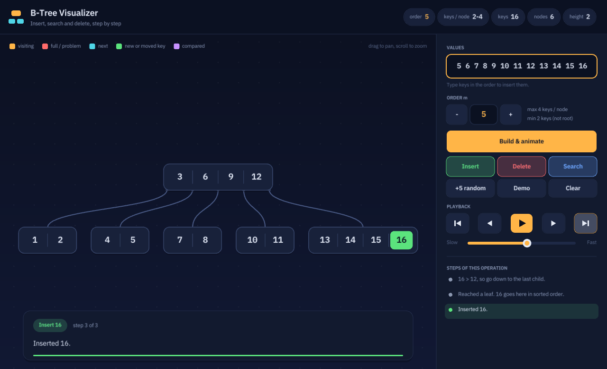

# B-Tree Animation (C++)

Give a list of **values** and the **order m** of the B-Tree, and watch the tree being built step by step:
going down the tree, overflow, splitting at the median, and the tree growing taller. You can also search and
delete keys and watch the borrow and merge steps.



| File | What it is |
|---|---|
| `btree_visualizer.html` | **Zero-install web visualizer**: open it in any browser, type values, get the animated tree |
| `btree.h` | The B-Tree algorithm for any order m (insert, search, delete), with a hook for every step |
| `gui/btree_gui.cpp` | **B-Tree Visualizer**: graphical app (raylib) with smooth animations |
| `btree_animation.cpp` | Terminal animation using ANSI colours, no libraries needed |
| `tests/test_btree.cpp` | Randomised test: orders 3–10, checks every B-Tree rule after each operation |

### What "order m" means

A B-Tree of order m (Knuth's definition, used in most textbooks):
- every node has at most **m children** and **m − 1 keys**
- every node except the root has at least **⌈m/2⌉ − 1 keys**
- all leaves are on the same level

When a node gets m keys it overflows and splits at the median; the median moves up to the parent.

## Graphical visualizer

```bash
cmake -B build
cmake --build build
./build/btree_gui            # Windows: build\Debug\btree_gui.exe
```

raylib is downloaded automatically the first time. On Linux install the X11/OpenGL development packages first:
`sudo apt install libx11-dev libxrandr-dev libxinerama-dev libxcursor-dev libxi-dev libgl1-mesa-dev`.

**How to use it**
1. Type the values in the **Values** box, in the order you want them inserted (`10 20 5 6 12 30`).
2. Choose the **order m** with **−** / **+** (3 to 10).
3. Press **Build & animate**. The tree starts empty and each value is inserted with every step shown.

Then:
- **Insert**, **Delete** and **Search** work on the current tree using the values in the box (Enter = Insert).
- Playback: first step, previous step, play/pause, next step, skip to end. The slider sets the speed.
- Click any line in **Steps of this operation** to jump to that step.
- Drag to pan, scroll to zoom, **F** to fit, **Space** to play/pause, **← / →** to step.

**Web build** (same C++ code, compiled with Emscripten):

```bash
emcmake cmake -B build-web -DPLATFORM=Web -DBUILD_CONSOLE=OFF
cmake --build build-web          # produces build-web/btree_gui.html
```

## Terminal animation

```bash
g++ -std=c++11 -O2 -o btree_animation btree_animation.cpp
./btree_animation                              # asks for the order and the values
./btree_animation -m 4 10 20 30 40 50 60 70    # order 4 with these values
./btree_animation --demo                       # automatic demo
```

```
  Enter the ORDER of the B-Tree (3-20): 4
  Enter the VALUES to insert, in order (e.g. 10 20 5 6 12): 10 20 30 40 50 60 70

         [30|60]
            |
     +------+-+-------+
     |        |       |
  [10|20]  [40|50]  [70]
```

After building, these commands are available:

| Command | Meaning |
|---|---|
| `new` | enter a new order and values, then animate |
| `i 10 20` / `d 20` / `s 15` | insert, delete, search |
| `order 5` | change the order (keeps the keys) |
| `r 10` | insert 10 random keys |
| `step` | press ENTER for each frame |
| `speed 300` | milliseconds between frames |
| `demo`, `clear`, `help`, `q` | demo, empty the tree, help, quit |

## Tests

```bash
cmake --build build && ctest --test-dir build
```

Fonts: IBM Plex Sans and IBM Plex Mono, SIL Open Font License (`gui/assets/fonts/OFL.txt`).
